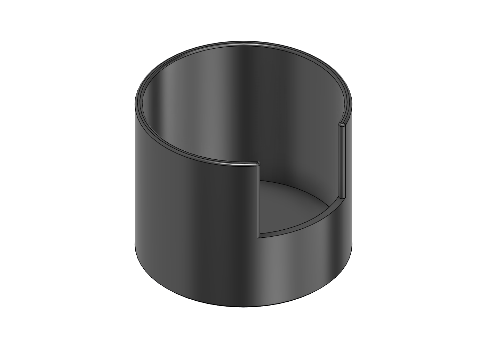
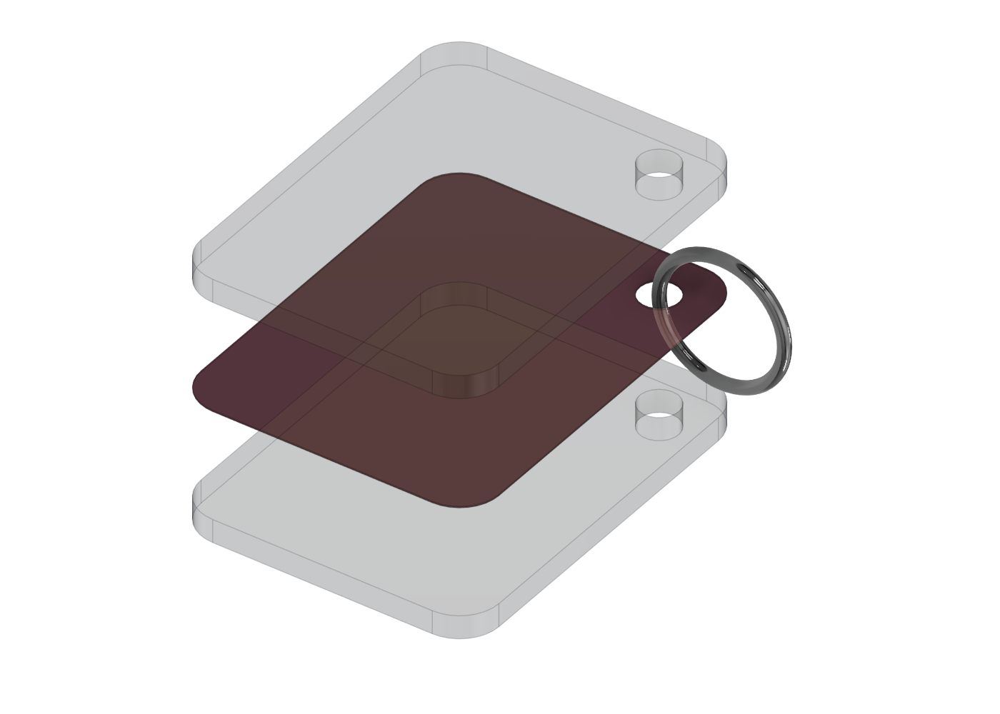

# fusion-studio

[](https://github.com/shadowtor/fusion-studio/actions/workflows/test.yml) [](LICENSE)

**An Agent Skill for designing 3D models in Autodesk Fusion with your AI agent** (tested with Claude Code; the installer also targets Codex CLI
and Gemini CLI, and any agent that reads Agent Skills folders). It drives Fusion through its local MCP server: you bring measurements and photos, it builds a parametric
model, looks at its own screenshots, checks the result and exports it. It asks first whether the project is something you will
**print**, a **showcase** piece, or an **apparel** mockup, because that changes how the model is built.

 

<sub>Two examples built by the skill: a PETG Monster can holder (Print mode) and an acrylic keychain in an exploded view (Showcase mode). Scripts, screenshots and exports are in [`examples/`](examples).</sub>

**Website:** [shadowtor.github.io/fusion-studio](https://shadowtor.github.io/fusion-studio/)

**Contents:** [Modes](#the-three-modes) · [What it does](#what-it-does) · [Install](#install) · [Use](#use) · [Example](#example) · [Limits](#what-it-will-not-do) · [Develop](#develop) · [Help](#help-and-status) · [Credits](#credits)

## The three modes

| Mode | For | Built as | Exports |
|---|---|---|---|
| **Print** | Parts you print: holders, brackets, enclosures, keychains. PLA, PETG, ASA and others. Default printer Bambu Lab H2C | Fit clearances, wall rules, orientation, one component per printed part | 3MF per part, STEP |
| **Showcase** | Items that are shown, not printed: acrylic keychains for a crowdfunding page, exploded views for video | Real material thickness, layered parts, exploded layout from one `explode_gap` parameter | Transparent PNG per angle, OBJ, STEP |
| **Apparel** | Clothing brand mockups: hang tags, label plates, buttons, zip pulls, hat badges, packaging | Flat artwork on thin 3D trims, real thickness | PNG views, STEP, artwork notes |

Details: [`references/modes.md`](skills/fusion-studio/references/modes.md).

## What it does

- **Connects** to the Fusion MCP server at `http://127.0.0.1:27182/mcp` through the MCP tools, or through a small stdlib client (`fusion_mcp.py`) when the tools are not loaded.
- **Protects your work.** It opens a fresh document for every new design. It never edits a document you already have open, and never saves or closes without being asked.
- **Parameters first.** Measured, fit and derived values are named user parameters with comments. Sketch dimensions and extrusions use them, so one changed number updates the whole model.
- **Designs for the filament.** In Print mode you name the filament (PLA, PETG, ABS, ASA, TPU, nylon, PC, carbon-filled) and it loads that material's diametral fits, its limits for wall thickness, overhang angle and bridge length, a hole compensation, and notes. `print_check()` then reads the finished model for thin walls, overhangs, long bridges and small or horizontal holes. `fit_coupon()` builds a clearance test print so fits are calibrated, not guessed. See [`materials.md`](skills/fusion-studio/references/materials.md).
- **Checks the model in the slicer.** `slicer_check.py` runs OrcaSlicer headless on the Bambu H2C profiles: watertight or not, print time, filament, whether the orientation needs supports, and whether the slicer would pick a different orientation. No MCP server needed. An optional [orcaslicer-mcp](https://github.com/maxellis/orcaslicer-mcp) route is described in [`slicer.md`](skills/fusion-studio/references/slicer.md).
- **Looks at its work.** A screenshot after each build step, a timeline health check, a bed-fit report, and a parameter-change test before it calls anything done.
- **Says what is unproven.** A model that looks right has not been printed. The handover names the first test print and the parameter to tune.

## Install

You need Python 3.8+, Autodesk Fusion with its MCP server enabled, and an agent that reads skills folders. No packages are installed.

### A. Claude Code plugin marketplace

```text
/plugin marketplace add shadowtor/fusion-studio
/plugin install fusion-studio@fusion-studio
```

### B. Installer script (Claude Code, Codex CLI, Gemini CLI, any agent)

```bash
git clone https://github.com/shadowtor/fusion-studio.git
cd fusion-studio
python tools/install.py --claude --codex          # or --gemini, --project, --dest <folder>, --link
python skills/fusion-studio/scripts/check_setup.py
```

Manual alternative: copy `skills/fusion-studio` to `~/.claude/skills/fusion-studio` (or the Codex or Gemini equivalent). Start a **new session** afterwards.

### C. Let your AI agent install it

```text
Install the "fusion-studio" Agent Skill for me.

1. Clone https://github.com/shadowtor/fusion-studio (or git pull if I already have it) and read
   docs/INSTALL-FOR-AGENTS.md in it. Follow that file exactly.
2. Install it for the agent I am using right now. Only copy the skills/fusion-studio folder.
3. Run: python skills/fusion-studio/scripts/check_setup.py. If it reports a FAIL, show me the line and stop.
4. Tell me where it was installed and that I must start a new session. Do not commit, push or download anything else.
```

## Use

Start Fusion, then ask your agent for something to model:

> I want a desk holder for a tall Monster can with a finger notch so it lifts out. PETG, the can is about 66 mm wide.

It asks which mode you are in, confirms the material and any measurements it lacks, then builds. Typical requests:

- "Make a bracket for this bar, here are the measurements and a photo."
- "Acrylic keychain for the Kickstarter page, show it exploded, transparent PNGs."
- "A hang tag and a woven label plate for my brand, using the brand-studio kit."
- "The holder is too tight, tune it": the agent edits one parameter and re-checks the model.

## Example

Both were produced end to end by the skill in new Fusion documents.

**[`monster-can-holder`](examples/monster-can-holder)** (Print, PETG)

| Check | Result |
|---|---|
| Timeline | 11 features, 0 problems |
| `print_check` | 0 warnings. It first flagged a 0.6 mm knife edge where the finger notch meets the round wall, so the notch corners are now filleted |
| Slicer (`slicer_check.py`, H2C, PETG, 0.20 mm) | Watertight, 1 h 32 min, 36.7 g, no supports needed even when forced on, and the slicer's best orientation matches the export |
| Size | 72 x 72 x 58.2 mm, 39.2 cm3, fits the H2C bed |
| Parameter test | `can_dia` 66 to 70 mm and back: outside diameter 72 to 76 mm and back, 0 problems both ways |
| Exports | `can-holder.3mf`, `can-holder.step`, screenshots |
| **Not proven** | Fit. The can size is an assumption and nothing has been printed. Measure your can, print once, tune `fit_xy` |

**[`acrylic-keychain`](examples/acrylic-keychain)** (Showcase)

| Check | Result |
|---|---|
| Timeline | 17 features, 0 problems |
| Parts | Two 3 mm acrylic layers, a 0.2 mm art sheet, a chrome split ring through the hole |
| Exploded view | One `explode_gap` parameter moves the parts without adding timeline items |
| Exports | Transparent `exploded.png` and `assembled.png`, `keychain.obj`, `keychain.step` |
| **Not covered** | Real artwork (the sheet is a flat colour) and FBX (this Fusion version has no FBX export) |

## What it will not do

- Send jobs to your printer or choose temperatures and speeds. It slices only to check a model.
- Replace a test print. Fits and limits are starting values for a 0.4 mm nozzle (only the overhang, wall and fit ranges come from published sources, the per-material numbers are this project's defaults), and shrinkage depends on your filament brand. Print the fit coupon.
- Read dimensions off a photo. It asks you for them.
- Model fabric. Apparel mode covers rigid trims, labels, tags and packaging.
- Work without Fusion running with its MCP server on.

## Develop

```bash
python tools/smoke_test.py          # checks the skill files, scripts compile, and (if Fusion is running) a live build
python tools/package_skill.py       # dist/fusion-studio.zip
python skills/fusion-studio/scripts/slicer_check.py part.3mf --material PETG   # slice check (needs OrcaSlicer)
python tools/make_social_card.py    # site/social-card.png
```

See [`CONTRIBUTING.md`](CONTRIBUTING.md) and [`docs/architecture.md`](docs/architecture.md).

## Help and status

Questions and bugs go in [issues](https://github.com/shadowtor/fusion-studio/issues). This is a one-person project in active use, so expect a reply within a week or so, not a day. Security problems: see [`SECURITY.md`](SECURITY.md). Contributions: [`CONTRIBUTING.md`](CONTRIBUTING.md). Everyone taking part follows the [code of conduct](CODE_OF_CONDUCT.md).

## Credits

These shaped the design. I read them and copied none of their text or code:
[Misterbra/fusion360-claude-ultimate](https://github.com/Misterbra/fusion360-claude-ultimate) (an MCP bridge for Fusion),
[HazAT/codex-fusion-360](https://github.com/HazAT/codex-fusion-360) (print-oriented modelling guidance: parameters first,
one component per part, fillets late, honest verification),
[Markforged's design tips](https://markforged.com/resources/learn/design-for-additive-manufacturing-plastics-composites/3d-printing-strategies-for-composites/composites-3d-printing-design-tips) (diametral fits, unit-test prints),
[All3DP](https://all3dp.com/2/3d-modeling-for-3d-printing-the-main-considerations/) and [Objective3D](https://www.objective3d.com.au/resource/blog/optimising-3d-print-designs/) (overhang, hole and wall rules),
and [maxellis/orcaslicer-mcp](https://github.com/maxellis/orcaslicer-mcp) (the optional slicer route). Printer facts come from [Bambu Lab's H2C post](https://blog.bambulab.com/bambu-lab-h2c-where-multi-material-vortek-system-meets-engineering-precision).
Not affiliated with Autodesk or Bambu Lab. Fusion is a trademark of Autodesk, Inc.

MIT licence, see [`LICENSE`](LICENSE).
